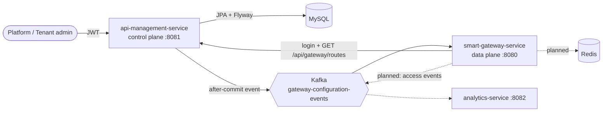

# GateKeeper: Multi-Tenant API Gateway & Management Platform

A microservice-based API gateway platform built with Java and Spring Boot. A **control plane** lets platform admins and tenant admins manage organizations and API routes. A **data plane** (the gateway) loads those routes and stays in sync through Kafka events.

> **Status: work in progress.** The control plane and the configuration-sync flow are built. Request proxying, rate limiting and analytics are not built yet. See [Roadmap](#roadmap).

## Architecture



| Service | Port | Role | State |
|---|---|---|---|
| `api-management-service` | 8081 | Auth, organizations, routes, versioning, audit trail, Kafka publisher, small admin UI | Built |
| `smart-gateway-service` | 8080 | Logs in to the management API, loads active routes, refreshes on each Kafka event | Config sync built, proxying not yet |
| `analytics-service` | 8082 | Access-event storage and usage stats | Skeleton (health endpoint only) |

## What is implemented

- JWT authentication (HS256) with three roles: `PLATFORM_ADMIN`, `TENANT_ADMIN`, `GATEWAY_SERVICE`
- Tenant-scoped CRUD for organizations and API routes
- Route configuration versioning and a control-plane audit trail
- Flyway schema migrations, request validation, centralized exception handling
- Kafka events published **after the database transaction commits**, so the gateway never hears about a change that was rolled back
- Gateway service that authenticates to the management API, loads active routes into memory, and reloads on each event
- Jenkins pipeline for the management service (compile, test, package, deploy, smoke test) and a Docker Compose file for MySQL, Kafka and Redis

## Run it locally

**Prerequisites:** Java 21, Docker with Compose.

1. Create your config file and fill in your own values (it is git-ignored):

   ```bash
   cp .env.example .env
   openssl rand -base64 48        # use output for GATEKEEPER_JWT_SECRET
   ```

   | Variable | Purpose |
   |---|---|
   | `GATEKEEPER_DB_PASSWORD` | MySQL root password (used by the container and the service) |
   | `GATEKEEPER_JWT_SECRET` | JWT signing key, at least 32 characters |
   | `GATEKEEPER_PLATFORM_ADMIN_PASSWORD` | Password for the `platform-admin` account, at least 12 characters |
   | `GATEKEEPER_GATEWAY_PASSWORD` | Password for the `gateway-service` account, at least 12 characters |

2. Start the infrastructure:

   ```bash
   docker compose up -d
   ```

   If you already run MySQL on port 3306 locally, stop it first or change the port mapping in `compose.yaml`.

3. Start the services, each in its own terminal, from the repo root:

   ```bash
   cd api-management-service && ./mvnw spring-boot:run
   cd smart-gateway-service  && ./mvnw spring-boot:run
   ```

   The services read `.env` from the repo root, or from real environment variables.

4. Check health: `curl localhost:8081/health` and `curl localhost:8080/health`. The management UI is at http://localhost:8081.

### Accounts

There are **no hardcoded users or passwords in this repo**. On first start the management service creates `platform-admin` and `gateway-service` using the passwords from your `.env`, if those accounts do not exist yet. Tenant admins are created by a platform admin through the API.

## Sample API calls

```bash
# 1. Log in as platform admin
TOKEN=$(curl -s localhost:8081/api/auth/login -H 'Content-Type: application/json' \
  -d '{"username":"platform-admin","password":"<your GATEKEEPER_PLATFORM_ADMIN_PASSWORD>"}' | jq -r .token)

# 2. Create an organization
curl -s localhost:8081/api/platform/organizations -H "Authorization: Bearer $TOKEN" \
  -H 'Content-Type: application/json' -d '{"name":"Demo Shop","slug":"demo-shop"}'

# 3. Create its tenant admin (use the organization id from step 2)
curl -s localhost:8081/api/platform/organizations/1/tenant-admin -H "Authorization: Bearer $TOKEN" \
  -H 'Content-Type: application/json' -d '{"username":"demo-shop-admin","password":"choose-a-password"}'

# 4. Log in as the tenant admin and create a route
TENANT_TOKEN=$(curl -s localhost:8081/api/auth/login -H 'Content-Type: application/json' \
  -d '{"username":"demo-shop-admin","password":"choose-a-password"}' | jq -r .token)

curl -s localhost:8081/api/tenant/routes -H "Authorization: Bearer $TENANT_TOKEN" \
  -H 'Content-Type: application/json' -d '{
    "routeId": "orders",
    "name": "Orders API",
    "pathPattern": "/orders/**",
    "targetBaseUrl": "http://localhost:9000",
    "targetPathPrefix": "/api/orders",
    "requestsPerMinute": 100,
    "responseTimeoutMs": 3000,
    "idempotencyEnabled": false,
    "active": true,
    "allowedMethods": ["GET", "POST"],
    "headerRules": []
  }'
```

The gateway log should show the configuration event and the reloaded routes after step 4.

## API overview (management service)

| Area | Endpoints | Role |
|---|---|---|
| Auth | `POST /api/auth/login` | public |
| Organizations | `/api/platform/organizations` (CRUD, `PATCH /{id}/status`), `/{id}/tenant-admin` | `PLATFORM_ADMIN` |
| Own organization | `GET`, `PUT /api/tenant/organization` | `TENANT_ADMIN` |
| Routes | `/api/tenant/routes` (CRUD, `PATCH /{id}/status`), `/api/tenant/route-versions/{routeId}`, `/api/tenant/audit-records` | `TENANT_ADMIN` |
| Gateway sync | `GET /api/gateway/routes` | `GATEWAY_SERVICE` |

## Deployment note (Jenkins)

The `Jenkinsfile` builds the management service. Its deploy stage expects a file `/opt/cicd-demo/spring/gatekeeper.env` on the server holding the same variables as `.env`, so secrets stay out of the repo.

## Roadmap

- [ ] Gateway core: match `pathPattern`, proxy with timeouts, enforce allowed methods, apply header rules
- [ ] Redis-based rate limiting per tenant and route, plus `Idempotency-Key` support
- [ ] Analytics service: access events through Kafka, usage stats per tenant and route
- [ ] Unit and integration tests (Testcontainers): tenant isolation, JWT and roles, route validation, Kafka flow
- [ ] Hardening: block internal/localhost targets (SSRF), login throttling, pagination, outbox or retry for Kafka publishing, structured logging, Actuator metrics
- [ ] Dockerfile per service and a single compose file for the whole stack

## Tech stack

Java 21, Spring Boot, Spring Security (OAuth2 resource server, JWT), Spring Data JPA, MySQL, Flyway, Apache Kafka, Redis, Docker Compose, Jenkins, Maven.
